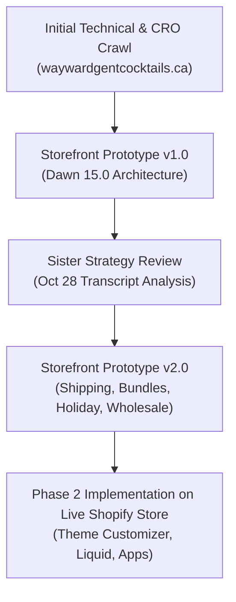

# Project Status: Wayward Gent Cocktails Modernization & Growth

> **Project:** Wayward Gent Cocktails Storefront Modernization, CRO, and SEO Upgrade  
> **Client / Store:** [Wayward Gent Cocktails](https://waywardgentcocktails.ca/) (Norwood, Ontario, Canada)  
> **Founder / Owner:** Tam (Affiliated with *The CakeHouse* Bakery)  
> **Consultant:** Scott  
> **Status:** Phase 1 Complete • **Prototype v2.0 Released** (Post-Sister Review Update)  
> **Live Prototype URL:** [https://scottrepository.github.io/wayward-gent-prototype/](https://scottrepository.github.io/wayward-gent-prototype/)  
> **GitHub Repository:** [ScottRepository/wayward-gent-prototype](https://github.com/ScottRepository/wayward-gent-prototype)  
> **Local Prototype File:** [`/home/scottcarpentier/wayward-gent-prototype/index.html`](file:///home/scottcarpentier/wayward-gent-prototype/index.html)  
> **Last Updated:** October 28, 2026  

---

## 1. Project Overview & Tech Stack

### 1.1 Executive Summary
Wayward Gent Cocktails handcrafts upscale cocktail infusions (available in reusable mason jars or eco-friendly refill sachets), inventive freeze-dried simple syrup pucks, flavoured glass rimmers, and hosts mixology workshops in Norwood and Peterborough, Ontario.

Following an in-depth strategy review between Scott and Tam on October 28, 2026, the interactive prototype has been upgraded to **Version 2.0**. This release reflects Tam's specific real-world operational requirements, shipping economics across Canada, seasonal holiday kits, and wholesale account handling.

---

## 2. Updates Implemented in Prototype v2.0 (From Sister Feedback)

| Feature / Area | Previous Setting | **Sister Feedback (Tam) & v2.0 Update** | Strategic Rationale |
| :--- | :---: | :--- | :--- |
| **Free Shipping Threshold** | $75 CAD | **Updated to $200 CAD** (and free local pickup at *The CakeHouse* in Norwood) | Canadian parcel shipping costs $18–$25+. Offering free shipping on $75 erodes profit margins. $200 matches the live store setting and protects profitability. |
| **"How It Works" Section** | Static 3-step text cards | **Added visual 72-Hour Timer Countdown** (⏱️ 72:00:00 "tick tick tick" animation) + yield counter | Visually demonstrates the 72-hour steeping process; primes buyers for Tam's video demonstrations. |
| **Bundle Architecture** | Generic 3-pack switcher | **4 Distinct Bundle Modes:** 1. *3x Refill Sachets* ($40.80 / Save 15%) 2. *3x Glass Jars* ($51.00 / Save 15%) 3. *Sachet Cocktail Trio* ($30.60 / Save 15%) 4. *Jar Cocktail Trio* ($34.00 / Save 15%) | Strictly separates jars from sachets to avoid customer confusion. Prevents shipping empty jars (which cost Tam $250 in freight to receive). |
| **Packaging & Gifts** | Standard cart add | **Interactive Holiday Gift Box Add-On (+ $10 CAD)** | Includes decorative kraft gift box, holiday cocktail picks, and custom fillable ornaments with dried citrus slices. |
| **Pre-Made Holiday Kits** | None | **Dedicated Holiday Kits Tab:** • *The Old Fashioned Holiday Kit ($35)* • *The Mistletoe Mule Kit ($38)* • *The Ultimate Caesar Duo ($32)* | Captures high-intent Q4 holiday gift shoppers looking for complete, ready-to-wrap gift sets. |
| **Cocktail Hour Society** | External Flodesk link | **Tiered Membership + The CakeHouse Upsell:** • *Free Tier:* 10% welcome discount (`WAYWARD10`) • *Speakeasy VIP ($9/mo):* Behind-the-scenes videos • *The Cocktail Box ($75/mo or $150 3-mo gift)* • **Baker's Box Add-On (+ $50/mo):** Fresh treats from The CakeHouse bakery | Eliminates off-site dropoff; builds predictable recurring revenue; cross-sells bakery loyalists. |
| **Wholesale System** | Inquiry form only | **Dual Portal:** 1. *Existing Partner Login:* Uses Shopify wholesale app for automatic tiered pricing 2. *New Account Application:* Features clear **$250 CAD Minimum Order** | Preserves existing wholesale order flow while qualifying prospective retailers for Toronto Market Week. |

---

## 3. Current State of the Codebase & Assets

### 3.1 Local & Remote Files
- Master Prototype: [`/home/scottcarpentier/wayward-gent-prototype/index.html`](file:///home/scottcarpentier/wayward-gent-prototype/index.html)
- Project Documentation: [`/home/scottcarpentier/wayward-gent-prototype/PROJECT_STATUS.md`](file:///home/scottcarpentier/wayward-gent-prototype/PROJECT_STATUS.md)
- Complete Audit Report: [`/home/scottcarpentier/wayward-gent-prototype/wayward_gent_audit_and_recommendations.md`](file:///home/scottcarpentier/wayward-gent-prototype/wayward_gent_audit_and_recommendations.md)
- GitHub Repository: [ScottRepository/wayward-gent-prototype](https://github.com/ScottRepository/wayward-gent-prototype)
- Live GitHub Pages Link: [https://scottrepository.github.io/wayward-gent-prototype/](https://scottrepository.github.io/wayward-gent-prototype/)

---

## 4. Priorities & Next Steps on Roadmap

### Phase 1: Deploy & Share Prototype v2.0
- [x] Integrate all sister feedback from Oct 28 strategy meeting.
- [x] Update local workspace repository (`/home/scottcarpentier/wayward-gent-prototype/`).
- [ ] Push updated HTML to GitHub repository (`ScottRepository/wayward-gent-prototype`) to refresh GitHub Pages for Tam's review.

### Phase 2: Live Shopify Theme Configuration (Dawn v15.0)
- [ ] **Shipping Policy:** Update `/policies/shipping-policy` in Shopify Admin with the $200 threshold, flat rates, and Norwood pickup.
- [ ] **Our Story Page:** Publish the finalized CakeHouse / Tam narrative on `/pages/about-us`.
- [ ] **How-To Guide:** Replace the 480x480 graphic on `/pages/how-to-use` with structured text.
- [ ] **Shopify Bundles App (Free):** Create the 4 pre-set kits and 3-pack bundles in Shopify Admin.
- [ ] **Flodesk On-Site Integration:** Embed the newsletter form on `/pages/cocktail-hour-society` and enable exit-intent modal.
