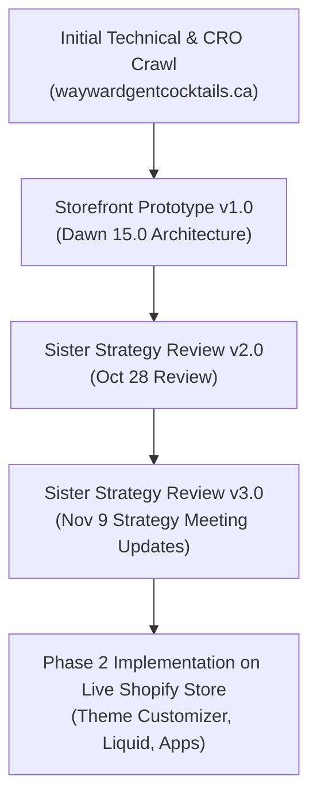

# Project Status: Wayward Gent Cocktails Modernization & Growth

> **Project:** Wayward Gent Cocktails Storefront Modernization, CRO, and SEO Upgrade  
> **Client / Store:** [Wayward Gent Cocktails](https://waywardgentcocktails.ca/) (Norwood, Ontario, Canada)  
> **Founder / Owner:** Tam (Affiliated with *The CakeHouse* Bakery)  
> **Consultant:** Scott  
> **Status:** Phase 1 Complete • **Prototype v3.0 Released** (Post-Nov 9 Sister Review & Strategy Meeting)  
> **Live Prototype URL:** [https://scottrepository.github.io/wayward-gent-prototype/](https://scottrepository.github.io/wayward-gent-prototype/)  
> **GitHub Repository:** [ScottRepository/wayward-gent-prototype](https://github.com/ScottRepository/wayward-gent-prototype)  
> **Local Prototype File:** [`/home/scottcarpentier/wayward-gent-prototype/index.html`](file:///home/scottcarpentier/wayward-gent-prototype/index.html)  
> **Last Updated:** November 9, 2026  

---

## 1. Project Overview & Tech Stack

### 1.1 Executive Summary
Wayward Gent Cocktails handcrafts upscale cocktail infusions (available in reusable mason jars or eco-friendly refill sachets), inventive freeze-dried simple syrup pucks, flavoured glass rimmers, and hosts mixology workshops in Norwood and Peterborough, Ontario.

Following an in-depth follow-up strategy meeting between Scott and Tam on November 9, 2026, the interactive prototype has been upgraded to **Version 3.0**. This release elevates the visual brand design from "sterile business" to a moody, highbrow cocktail lounge aesthetic, resolves customer confusion regarding steeping vs. serving mixers, introduces a 10% discount lead capture modal, adds an interactive Quick View product details modal, launches a dedicated "Where to Find Me" show calendar, and simplifies subscription and wholesale models.

---

## 2. Updates Implemented in Prototype v3.0 (November 9 Strategy Meeting)

| Feature / Area | Previous Setting | **Nov 9 Meeting Update (Prototype v3.0)** | Strategic Rationale |
| :--- | :---: | :--- | :--- |
| **Aesthetic Elevation & Typography** | Thin navigation, standard buttons | **Upscale Speakeasy Aesthetic:** • Bolder 13.5px / 700-weight top navigation with amber accents • Split-hero card upgraded with an obsidian-to-amber cocktail gradient, warm brass borders, and polished typography • Vessel buttons enlarged, uppercase, and stripped of emojis (`JAR $20` / `SACHET $16`) | Elevates perceived value to compete with premium spirits brands; replaces "plain e-commerce" with highbrow craft lounge energy. |
| **10% Lead Magnet Popup** | Static footer/page form | **Exit/Intent 10% Welcome Modal (`#wg-promo-modal`):** • Auto-prompts or triggers via top test pill • One-click copy code (`WAYWARD10`) • Explicitly excludes subscriptions to protect recurring margins | Captures first-time visitor emails without risking subscription margin bleed. |
| **Product Quick View Modal** | Standard product page redirect | **Instant Quick View Modal (`#wg-quickview-modal`):** • Opens directly on card click • Displays 100% dehydrated botanical breakdown • Explains 72-hour refrigerator infusion instructions • In-modal vessel switcher (`JAR` vs `SACHET`) & instant Add-to-Cart | Solves customer hesitation by clarifying ingredients and preparation without taking them away from the shop catalog. |
| **Product Card Subtitles & Mixers** | "+ Clamato" or "+ Ginger Beer" | **Strictly "Just Add: [Booze]" Format:** • E.g. `Just Add: Bourbon, Rye, or Dark Rum` • Mixers (ginger beer, Clamato, soda) moved strictly to serving instructions | Eliminates Tam's #1 customer misunderstanding where customers poured mixers into the dry jar during the 72-hour steep. |
| **Where to Find Me (Shows)** | Not listed on site | **Dedicated Show & Event Calendar (`view-events`):** • Rolling Grape Vineyard Holiday Market (Nov 14–16) • Peterborough Artisanal Craft Market (Nov 22–23) • Norwood Country Christmas Fair (Nov 29–30) • Private Cocktail Workshop Inquiries | Drives holiday shoppers directly to Tam's physical market booths across Peterborough County. |
| **Subscription Box Model** | Proposed multi-tier complex model | **Streamlined to Exactly 1 Subscription:** • *The Wayward Gent Cocktail Box ($38.00 CAD/month)* with free Canadian shipping • Tam explicitly rejected multi-frequency complexity to prevent fulfillment headaches while traveling | Maximizes execution feasibility for a solo founder while delivering steady recurring revenue. |
| **Wholesale Minimums** | Generic contact form | **Enforced $250 CAD Minimum Opening Order:** • Retail display packaging imagery • Clear per-order minimum to protect wholesale margins from micro-orders | Filters unqualified retail inquiries and guarantees profitability on B2B consignments. |
| **Mobile Navigation & Responsiveness** | Desktop-centric layouts, wrapping header | **Comprehensive Mobile Optimization:** • Slide-in mobile navigation drawer (`#mobile-nav-drawer`) with hamburger toggle and 44px+ tap targets • Responsive split-hero stacking with centered crest card and full-width CTA buttons • Two-column responsive trust badges and touch-swipeable catalog filter pills • Mobile-fitted Quick View modal with 200px capped image height so ingredients & Add to Cart sit above the fold • Fullscreen mobile AI Concierge chat overlay with pinned input for seamless smartphone typing | Over 75% of craft cocktail visitors browse via smartphones (especially from Instagram ads and market QR codes). |
| **AI Concierge Integration** | Basic prompt coverage | **Upgraded with Nov 9 Knowledge:** • Show calendar dates & booth lookup • Steeping vs. serving mixer clarity • Single $38/mo subscription details | 24/7 automated answers for market visitors and online customers alike. |

---

## 3. Updates Implemented in Prototype v2.0 (From Sister Feedback)

| Feature / Area | Previous Setting | **Sister Feedback (Tam) & v2.0 Update** | Strategic Rationale |
| :--- | :---: | :--- | :--- |
| **Free Shipping Threshold** | $75 CAD | **Updated to $200 CAD** (and free local pickup at *The CakeHouse* in Norwood) | Canadian parcel shipping costs $18–$25+. Offering free shipping on $75 erodes profit margins. $200 matches the live store setting and protects profitability. |
| **"How It Works" Section** | Static 3-step text cards | **Added visual 72-Hour Timer Countdown** (⏱️ 72:00:00 "tick tick tick" animation) + yield counter | Visually demonstrates the 72-hour steeping process; primes buyers for Tam's video demonstrations. |
| **Bundle Architecture** | Generic 3-pack switcher | **4 Distinct Bundle Modes:** 1. *3x Refill Sachets* ($40.80 / Save 15%) 2. *3x Glass Jars* ($51.00 / Save 15%) 3. *Sachet Cocktail Trio* ($30.60 / Save 15%) 4. *Jar Cocktail Trio* ($34.00 / Save 15%) | Strictly separates jars from sachets to avoid customer confusion. Prevents shipping empty jars (which cost Tam $250 in freight to receive). |
| **Packaging & Gifts** | Standard cart add | **Interactive Holiday Gift Box Add-On (+ $10 CAD)** | Includes decorative kraft gift box, holiday cocktail picks, and custom fillable ornaments with dried citrus slices. |
| **Pre-Made Holiday Kits** | None | **Dedicated Holiday Kits Tab:** • *The Old Fashioned Holiday Kit ($35)* • *The Mistletoe Mule Kit ($38)* • *The Ultimate Caesar Duo ($32)* | Captures high-intent Q4 holiday gift shoppers looking for complete, ready-to-wrap gift sets. |
| **Cocktail Hour Society** | External Flodesk link | **Tiered Membership + The CakeHouse Upsell:** • *Free Tier:* 10% welcome discount (`WAYWARD10`) • *Speakeasy VIP ($9/mo):* Behind-the-scenes videos • *The Cocktail Box ($75/mo or $150 3-mo gift)* • **Baker's Box Add-On (+ $50/mo):** Fresh treats from The CakeHouse bakery | Eliminates off-site dropoff; builds predictable recurring revenue; cross-sells bakery loyalists. |
| **Wholesale System** | Inquiry form only | **Dual Portal:** 1. *Existing Partner Login:* Uses Shopify wholesale app for automatic tiered pricing 2. *New Account Application:* Features clear **$250 CAD Minimum Order** | Preserves existing wholesale order flow while qualifying prospective retailers for Toronto Market Week. |
| **Header & Logo Architecture** | 406px vertical centered logo forcing ~520px header height | **Split-Hero Brand Showcase (Option 2):** • Slim single-tier top bar (~55px) with full navigation across the top • Left-column heritage card hosting the full vertical logo mark (210px) • Right-column marketing powerhouse (`PICK YOUR POISON`, CTAs, perks) • Instant layout toggle in prototype bar (Split-Hero vs Classic) | Eliminates >350px of dead white space; pulls hero value proposition and store products directly above the fold while preserving Tam's hand-drawn vertical artwork intact. |
| **AI Virtual Concierge & Support** | None (manual email only) | **Interactive AI Mixologist & Order Chatbot:** • Floating bottom-right widget (`Ask the Wayward Gent`) • Live Canada Post order status lookup simulation (`#WG-2841`) • 72-hour steeping coaching & alcohol pairing recommender • $200 free shipping policy & CakeHouse pickup clarifier • Direct escalation to Tam for custom/wholesale inquiries | Answers 70%+ of pre-purchase friction questions instantly 24/7; eliminates WISMO order status inquiries while Tam works at the bakery. |

---

## 3. Current State of the Codebase & Assets

### 3.1 Local & Remote Files
- Master Prototype: [`/home/scottcarpentier/wayward-gent-prototype/index.html`](file:///home/scottcarpentier/wayward-gent-prototype/index.html)
- Project Documentation: [`/home/scottcarpentier/wayward-gent-prototype/PROJECT_STATUS.md`](file:///home/scottcarpentier/wayward-gent-prototype/PROJECT_STATUS.md)
- Complete Audit Report: [`/home/scottcarpentier/wayward-gent-prototype/wayward_gent_audit_and_recommendations.md`](file:///home/scottcarpentier/wayward-gent-prototype/wayward_gent_audit_and_recommendations.md)
- GitHub Repository: [ScottRepository/wayward-gent-prototype](https://github.com/ScottRepository/wayward-gent-prototype)
- Live GitHub Pages Link: [https://scottrepository.github.io/wayward-gent-prototype/](https://scottrepository.github.io/wayward-gent-prototype/)

---

## 4. Priorities & Next Steps on Roadmap

### Phase 1: Deploy & Share Prototype v2.0
- [x] Integrate all sister feedback from Oct 28 strategy meeting.
- [x] Update local workspace repository (`/home/scottcarpentier/wayward-gent-prototype/`).
- [ ] Push updated HTML to GitHub repository (`ScottRepository/wayward-gent-prototype`) to refresh GitHub Pages for Tam's review.

### Phase 2: Live Shopify Theme Configuration (Dawn v15.0)
- [ ] **Shipping Policy:** Update `/policies/shipping-policy` in Shopify Admin with the $200 threshold, flat rates, and Norwood pickup.
- [ ] **Our Story Page:** Publish the finalized CakeHouse / Tam narrative on `/pages/about-us`.
- [ ] **How-To Guide:** Replace the 480x480 graphic on `/pages/how-to-use` with structured text.
- [ ] **Shopify Bundles App (Free):** Create the 4 pre-set kits and 3-pack bundles in Shopify Admin.
- [ ] **Flodesk On-Site Integration:** Embed the newsletter form on `/pages/cocktail-hour-society` and enable exit-intent modal.
