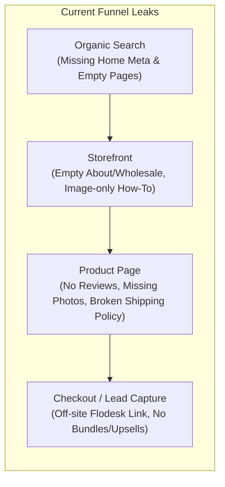
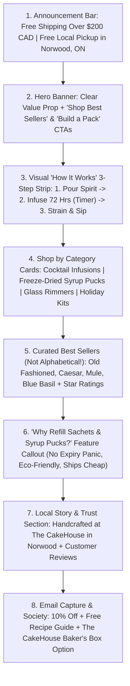

# Comprehensive Website Audit & Growth Plan: Wayward Gent Cocktails

**Store Audited:** `https://waywardgentcocktails.ca/`  
**Platform:** Shopify (Dawn Theme v15.0.0)  
**Catalog Size:** 42 Active Products across 15 Collections  
**Location:** Norwood / Peterborough, Ontario, Canada (affiliated with *The CakeHouse*)

---

## Executive Summary

**Wayward Gent Cocktails** has a fantastic product concept: handcrafted, locally sourced cocktail infusions (available in mason jars or eco-friendly refill sachets), inventive freeze-dried simple syrup "pucks" with zero expiry panic, flavoured glass rimmers, and in-person mixology classes.

However, the Shopify store currently looks and functions like a **half-finished template**. While several collection descriptions and product write-ups are well-written, **critical customer-facing pages are blank or broken**, zero social proof exists on the site, lead capture sends shoppers off-site with no incentive, and several technical SEO foundations are missing.

Below is a complete breakdown of every issue uncovered during the technical crawl, followed by a prioritized roadmap to **rank higher on Google (SEO)**, **capture more leads**, and **sell more online (CRO & AOV)**.

---

## Part 1: Urgent "Fix Immediately" Storefront Issues

Before spending money on ads or SEO, these foundational store breaks must be fixed—they are actively costing sales and hurting buyer trust right now.

> [!CAUTION]
> **1. The Shipping Policy Page Actually Says "No Refunds" (And Has Zero Shipping Info)**
> If a customer clicks **Shipping policy** in the footer (`/policies/shipping-policy`) or clicks *"Shipping calculated at checkout"* on any product page, the entire page reads:
> > *"Due to the nature of the product there is no refunds for items purchased"*
> 
> There is zero mention of shipping rates, carriers, processing times, where you ship (Ontario vs. Canada-wide), local pickup in Norwood/Peterborough, or free shipping thresholds (even though the `/collections/cocktail-infusions` meta description promises *"Free shipping available"*!).

> [!WARNING]
> **2. Three Main Navigation Pages Are Blank or Unusable**
> * **OUR STORY (`/pages/about-us`):** Completely blank (`

`). Customers buying artisanal food/drink products want to know who makes them, the connection to *The CakeHouse* bakery in Norwood, and your quality standards.
> * **WHOLESALE (`/pages/wholesale-test`):** Linked in the main header navigation, has `-test` in the URL, and is **100% blank**. Meanwhile, there is a hidden/unlinked collection at `/collections/wholesale-accounts` with 25 wholesale products and a note saying *"If you do not have an account yet please reach out"*, but no wholesale inquiry form!
> * **HOW TO USE (`/pages/how-to-use`):** Contains **zero text**—only a single low-resolution (`480x480`) graphic (`IMG_4887_480x480.jpg`) with an empty `alt=""` tag. Google cannot read text inside images, and mobile users have to pinch-and-zoom to read how your infusions work.

> [!IMPORTANT]
> **3. Live Products With Missing Images, Outdated Dates, & "Copy" URLs**
> * **Zero Product Photos:** `ESPRESSO COCKTAIL RIMMER` and `SPICY MARGARITA COCKTAIL INFUSION` are live and in-stock on the store with **0 images** (showing a grey Shopify placeholder).
> * **Unedited Duplicated URL Handles:**
>   * Raspberry Pomegranate Simple Syrup has the URL `/products/copy-grapefruit-cardamom-simple-syrup`
>   * Cocktail Class December 1st has the URL `/products/cocktail-class-december-1st-6-8pm-copy`
>   * Mojito Cocktail Infusion has the generic URL `/products/cocktail-infusion`
>   * Gingerbread Infusion & Blueberry Lavender Syrup have `-1` appended (`/products/gingerbread-cocktail-infusion-1`)
> * **Past-Date Event Tickets Still Live:** The November & December Cocktail Class tickets from last holiday season are still active and purchasable (`In Stock`) in the catalog.
> * **Empty Collections Listed Publicly:** Clicking **SHOP ALL** or **COLLECTIONS** takes users to `/collections`, which displays **15 collections**, including **GARNISHES (0 products)**, **PLAIN JANE (0 products)**, **SPECIALTY (0 products)**, **HOME PAGE** (`frontpage`, internal Shopify collection), and **WHOLESALE ACCOUNTS**.

---

## Part 2: SEO Analysis & Recommendations (Rank Higher & Get Free Traffic)

### What's Working Well Right Now
* **Collection Meta Titles & Descriptions:** Someone already optimized about 10 of the collection meta tags nicely (e.g., `Cocktail Infusions – Craft Cocktail Mixes | Wayward Gent Cocktails`).
* **Clean Shopify Architecture:** Dawn 15.0.0 is fast, lightweight, and outputs `Organization`, `WebSite`, and `ProductGroup` JSON-LD structured data automatically.

### Critical SEO Gaps & How to Fix Them

#### 1. Fix the Homepage Title & Meta Description (Biggest Quick Win)
Right now, the most important page on the website—the homepage—has:
* **Current `<title>`:** `Wayward Gent Cocktails`
* **Current `<meta name="description">`:** **Missing completely** (and `og:description` is just `Wayward Gent Cocktails`).
* **Current `<h1>` tag:** Empty (`<h1></h1>` wrapped around the logo without text fallback).
* **Recommended Fix** (In *Shopify Admin → Online Store → Preferences*):
  * **Homepage Title:** `Wayward Gent Cocktails | Craft Cocktail Infusions, Simple Syrups & Rimmers (Made in Canada)`
  * **Homepage Meta Description:** `Handcrafted cocktail infusion kits, freeze-dried simple syrup pucks, and flavoured glass rimmers made in Norwood, Ontario. Just add your favourite spirit! Ships across Canada.`
  * **Homepage H1:** Make `"High Brow Cocktails Made Simple — Handcrafted in Ontario"` a proper `<h1>` heading in the hero banner.

#### 2. Turn "How To Use" & Blog Posts from Images into Searchable Text + Schema
* **The Problem:** Not only is `/pages/how-to-use` a single image, your blog post `/blogs/news/the-cakehouse-eggnog` says *"the recipe is below"* and then embeds a vertical image (`The_CakeHouse_Eggnog_Recipe.jpg`) with zero written ingredients or steps! And `/blogs/news/smokedmocha` has a copy-paste ChatGPT artifact calling the product *"Midnight Ember"* instead of *Smoked Mocha*.
* **The Fix:**
  * Write out step-by-step text instructions on `/pages/how-to-use` for:
    1. **Cocktail Infusions** (Jar vs. Sachet, best spirits to pair, 72-hour infusion guide, how to strain, shelf life, and **double-infusing / mocktail uses**).
    2. **Simple Syrup Pucks** (How the freeze-dried puck works, boiling ratio, storing/freezing in ice cube trays).
    3. **Cocktail Rimmers** (Best way to wet the rim and dip).
  * Type out full recipes in blog posts and add **Recipe Schema (JSON-LD)** so your cocktails appear in Google's Recipe Rich Snippets with photos and prep times.

#### 3. Target High-Intent Gift, Bachelorette & Local Keywords
People rarely search for a brand name they don't know yet, and "cocktail infusion puck" is a new concept to many shoppers. However, thousands of Canadians search every month for:
* *"Cocktail infusion kits Canada"* / *"Alcohol infusion jars Canada"*
* *"DIY cocktail gift set Canada"* / *"Hostess gifts Ontario"* / *"Groomsmen / Bridesmaid cocktail gifts"*
* *"Caesar rimmer spice Canada"* / *"Margarita rimmer set"*
* *"Cocktail making classes Peterborough / Kawarthas"*

**Actionable Content Strategy:**
1. Create a dedicated **Gifts & Bundles Collection** (`/collections/cocktail-gift-sets-canada`) targeting holiday, birthday, groomsmen, and hostess gift keywords.
2. Create a dedicated **Cocktail Classes & Private Events Page** (`/pages/cocktail-classes-peterborough`) targeting local searches for bachelorette parties, corporate team building, and date nights in Peterborough, Norwood, and the Kawarthas.
3. Rename `/blogs/news` from **"News"** to **"Cocktail Recipes & Mixology Guide"** (`/blogs/cocktail-recipes`) and publish 1 recipe per week linking directly to the infusion, syrup, and rimmer used.

#### 4. Clean Up Image Filenames & Alt Text
* Many homepage and product images use raw camera filenames like `IMG-9973.jpg`, `IMG_3447.jpg`, or `5D543D0F-B69B-48E8-91A3-F575C6A2CB95.jpg`, and secondary hover images on the homepage have empty `alt=""` attributes.
* **Fix:** Rename files descriptively before uploading (e.g., `apple-pie-cocktail-rimmer-wayward-gent.jpg`) and add descriptive alt text (e.g., `"Apple Pie Cocktail Rimmer jar with cinnamon sugar rimmed cocktail glass"`).

---

## Part 3: Lead Capture Strategy (Build Your Email & SMS List)

### What's Happening Right Now
1. **The "Cocktail Hour Society" Nav Link Sends Users Off-Site:** Clicking `COCKTAIL HOUR SOCIETY` in the main navigation takes users **off your website** to `https://waywardgentcocktails.myflodesk.com/cocktailhour`. Once a visitor leaves your Shopify domain for an external landing page, they rarely return to their cart.
2. **Zero Incentive on the Footer Email Box:** The footer simply says *"Subscribe to our emails"* with no value proposition or discount.
3. **No Pop-Up or Exit-Intent Capture:** There are no active lead-capture forms or pop-ups on the Shopify site (`scripts` check confirmed zero email/pop-up apps installed).

### How to 5x Lead Capture

| Strategy | How to Implement It | Why It Works |
| :--- | :--- | :--- |
| **1. Embed Flodesk Directly on Shopify (Or Switch to Shopify Email / Klaviyo)** | Instead of linking out to `myflodesk.com`, create a Shopify page (`/pages/cocktail-hour-society`) and embed the Flodesk inline form directly inside the page, **plus** enable an embedded Flodesk pop-up script on the store. | Keeps shoppers on `waywardgentcocktails.ca` with their cart intact while capturing their email. |
| **2. Offer a High-Converting Lead Magnet** | Replace *"Subscribe to our emails"* with a **2-part offer**:  **"Join the Cocktail Hour Society: Get 10% Off Your First Order + Our Free 'Home Bartender's 5-Minute Recipe & Appy Pairing Guide' PDF!"** *(Note: You already created an appy pairing download for your Peterborough class—repurpose it here!)* | "10% off + Free Recipe/Appy E-Book" converts at **5%–8% of traffic**, compared to <0.5% for a generic newsletter box. |
| **3. Add a 30-Second "Find Your Poison" Cocktail Quiz** | Use a free/low-cost Shopify quiz app (like *Octane AI*, *Quizell*, or *Shop Quiz*) titled **"What's Your Signature Drink? Take the 30-Second Quiz"**. Ask:  1. Favorite base spirit (Vodka, Gin, Tequila, Bourbon, Rum, or Mocktail?) 2. Flavor profile (Sweet & Fruity, Spicy, Savoury/Caesar, Cozy/Spiced?) 3. Shopping for yourself or a gift? Require email to unlock their personalized 3-product bundle + 10% off code. | Solves "paradox of choice" across 42 flavours while capturing zero-party data and driving immediate bundle purchases. |
| **4. Capture B2B / Wholesale & Private Event Leads** | Put a dedicated **Wholesale Inquiry Form** on `/pages/wholesale` (asking Business Name, Location, Store Type, Email) and a **Private Group / Bachelorette Class Inquiry Form** on a Classes page. | Wholesale orders and private group bookings ($60+/person) are massive high-ticket revenue streams that currently have no way to convert on the site. |

---

## Part 4: Selling More Online (Conversion Rate & Average Order Value)

Right now, your individual items are priced between **$7.00 (Syrup Pucks)**, **$13.00 (Rimmers)**, and **$16.00–$20.00 (Infusions)**. In Canadian e-commerce, shipping a heavy glass mason jar via Canada Post or courier costs $12–$18+. If a customer puts a single $13 rimmer or $16 infusion in their cart and sees a $15 shipping charge at checkout, **cart abandonment will exceed 80%**.

The secret to profitable e-commerce with $7–$20 food/beverage items is **raising Average Order Value (AOV) to $55–$85+** so shipping makes sense for both the customer and your margins.

### 1. Create "The Complete Cocktail Kit" Bundles (Instant AOV Booster)
You already sell the 3 parts of a complete drink: **Infusion ($16–$20) + Simple Syrup Puck ($7) + Rimmer ($13) = $36–$40**.
* **Create Pre-Built Kits & "Build-Your-Own" Bundles:**
  * **"Build Your Own 3-Pack Infusions"** (Buy 3 Jars for $51 or 3 Sachets for $40.80 — Save 15%).
  * **"The Ultimate Caesar Kit"** (`Julius Caesar Infusion` + `Julius Caesar Rimmer` = $32 Bundle).
  * **"The Ultimate Moscow Mule Kit"** (`Mule Infusion` + `Moscow Mule Rimmer` = $38 Bundle).
  * **"The Holiday Hostess Box"** (`Christmas Morning Infusion` + `Gingerbread Syrup Puck` + `White Christmas Rimmer`).
* You can set this up for **free** using Shopify's official **Shopify Bundles** app.

### 2. Add a Free Shipping Progress Bar in the Cart Drawer
* Set a clear threshold (**$200 CAD** + **Free Local Pickup in Norwood/Peterborough at The CakeHouse**) and display it in the top announcement bar.
* Add a dynamic progress bar in the slide-out cart tracking progress toward free shipping.

### 3. Cross-Sell Matching Rimmers & Syrups Directly on Product Pages
* When someone views `MULE COCKTAIL INFUSION`, they have no idea you also sell `MOSCOW MULE COCKTAIL RIMMER` unless they go hunting for it.
* Use Shopify's free **Search & Discovery** app to manually pair complementary products on every product page under a heading **"Complete the Cocktail (Pair With):"** so shoppers can 1-click add the matching rimmer ($13) and syrup puck ($7).

### 4. Clarify "JAR ($20)" vs. "SACHET ($16)" on Product Pages
* On infusion product pages, the variant selector simply says `VESSEL: [JAR] [SACHET]`. First-time visitors don't immediately know what "Sachet" means until they read the bottom of the paragraph.
* **Fix:** Rename the variant options to be benefit-driven:
  * `Glass Infusion Jar ($20)`
  * `Refill Pouch / Sachet Only - Use Your Own Jar ($16 - Save $4!)`
* Promoting **Sachets** is huge for your conversion rate: sachets can ship across Canada via oversized lettermail or lightweight flat-rate parcels for a fraction of the cost of heavy glass jars!

### 5. Add Customer Reviews & Social Proof (Currently 0 Reviews on Site)
* We checked the site code for review apps (Judge.me, Loox, Yotpo, Stamped, Fera) and found **none installed**.
* Install **Judge.me** (has a generous free tier on Shopify):
  * Automatically email past customers (including market/bakery buyers if you have their emails) asking for a photo review in exchange for a 15% discount coupon.
  * Display star ratings under product titles on the homepage and collection grids—this also adds `AggregateRating` schema so **gold stars show up in Google search results**.

### 6. Overhaul the Homepage Layout for Conversion
Currently, the homepage only has:
1. A banner image
2. A 3-sentence welcome blurb
3. A "Pick Your Poison / Shop All" image block
4. An 8-product grid ("Featured Products" sorted alphabetically starting with A, B, C—showing *Christmas Morning* alongside summer drinks)
5. A footer note about Interac E-Transfer

**Recommended High-Converting Homepage Blueprint:**

### 7. Clean Up the Footer Currency Selector & Payment Friction
* **Footer Currency Clutter:** Disable unused international markets in *Shopify Settings → Markets* so the site looks focused on Canadian CAD.
* **Fix the `"Pickup currently unavailable"` Error:** Configure Local Pickup properly in *Shopify Settings → Shipping and delivery → Local pickup* (for The CakeHouse in Norwood) or disable the "Pickup availability" block in the Dawn theme editor.

---

## Summary Action Checklist (Ordered by Impact & Ease)

### Phase 1: Immediate Storefront Fixes
- [ ] **Rewrite `/policies/shipping-policy`** with real shipping rates, delivery timelines, sachet vs. jar shipping info, $200 free shipping threshold, and local pickup details.
- [ ] **Write `/pages/about-us` (Our Story)** featuring Tam, *The CakeHouse* bakery in Norwood, locally sourced ingredients, and photos of the hand-packing process.
- [ ] **Replace the single image on `/pages/how-to-use`** with searchable HTML text headings, step-by-step instructions for Infusions, Syrup Pucks, and Rimmers, and an FAQ section.
- [ ] **Build `/pages/wholesale` (and fix the `-test` URL redirect)** with wholesale login button + new retailer inquiry form ($250 min order).
- [ ] **Update Homepage Title & Meta Description** in *Shopify Admin → Online Store → Preferences*.
- [ ] **Upload missing photos** for *Espresso Cocktail Rimmer* and *Spicy Margarita Cocktail Infusion*, and unpublish/update past-date Cocktail Class products.
- [ ] **Clean up `/collections` navigation** so empty collections (*Garnishes*, *Plain Jane*, *Specialty*) and internal collections (*Home page*, *Wholesale Accounts*) aren't cluttering the public collection directory.
- [ ] **Fix the broken URL handles** (`/products/copy-grapefruit-cardamom-simple-syrup`, etc.) and check the box in Shopify to create automatic 301 redirects.

### Phase 2: Lead Capture & Conversion Boosters
- [ ] **Install Judge.me (Free)** and collect 10–15 initial customer reviews across top infusions and syrups.
- [ ] **Embed Flodesk directly on a Shopify page + pop-up** with a **"10% Off + Free Cocktail & Appy Recipe Guide"** offer instead of sending users off-site.
- [ ] **Install Shopify Bundles (Free)** and create the 4 signature pack types (3 Sachets, 3 Jars, Sachet Trio, Jar Trio).
- [ ] **Install Shopify Search & Discovery (Free)** to add *"Complete the Cocktail"* cross-sells on every infusion product page.
- [ ] **Rename Variant Labels** from `JAR / SACHET` to `Glass Jar ($20) / Refill Sachet - Use Your Own Jar ($16)`.

### Phase 3: Ongoing Growth & Recurring Revenue
- [ ] **Turn Blog Posts into Real Written Recipes** with Recipe Schema so rich cards display on Google Images and Search.
- [ ] **Launch Cocktail Box Subscription & The CakeHouse Baker's Box Add-On** via Shopify Subscriptions ($75/mo + $50/mo add-on).
- [ ] **Set up Google Merchant Center (Free Listings)** via the Shopify *Google & YouTube* channel app so your products appear in the Google Shopping tab across Canada for free.
